<p align = "center">

</p>

# PDB2MC: Bridging Biomolecules and Minecraft for accessible, interactive 3D visualization.
### Author: Markus Nevil, PhD<br>Version: 2.0.6


**Table of Contents**
 - [Introduction](#introduction)
 - [Web version](#web-version)
 - [Installation](#installation)
   - [Issues and Questions](#issues-and-questions)
 - [General Program Procedure](#general-program-procedure)
 - [Preparing a Minecraft world](#preparing-a-minecraft-world-for-pdb-models)
 - [Walkthrough of an example GFP model](#walkthrough-of-an-example-gfp-model)
   - [Choose a structure](#choose-a-structure)
   - [Make the model in PDB2MC](#make-the-model-in-pdb2mc)
   - [Build the model in Minecraft](#build-the-model-in-minecraft)
 - [In-game commands](#in-game-commands)
 - [Description of Program modes](#description-of-program-modes)
 - [Description of options](#description-of-options)
   - [Tools](#tools)
   - [Default atom colors](#default-atom-colors)
 - [Command line](#command-line)
 - [Glossary of terms](#glossary-of-terms)
 - [Program Flowchart](#generalized-flowchart-of-program-procedure)
 - [Acknowledgements](#acknowledgements)
 - [Citation](#citation)
 - [License](#license)

## Introduction
The structures of proteins and other biomolecules determined by X-ray crystallography, NMR, and cryo-EM are published at
the RCSB Protein Data Bank (rcsb.org). These structures are primarily viewed using free or paid programs that are
powerful tools, yet whose learning curve may pose an inaccessible barrier for educators, students, and the public.
The purpose of the stand-alone `PDB2MC` program is to make a fun and accessible alternative by generating files that
can be loaded by the popular video game Minecraft.

<p align = "center">

</p>

`PDB2MC` comes with several example models, and can use any structure from the RCSB Protein Data Bank: a downloaded
`.pdb` or `.cif` file, or just its PDB ID (such as 1GFL), which the program downloads for you. A ready-to-run `.exe` is
available for Windows; on any other operating system, PDB2MC can be installed with Python 3.11 or newer.

This guide includes a quick start, a walkthrough of building the included GFP model, a description of every mode and
option, and a glossary of terms.

## Web version
There is an online-only version of PDB2MC that has limited functionality, but allows for the generation and viewing of models with and without a Minecraft installation.
At the time of writing (November 2026), these websites are active. <a href="https://pdb2mc.com">pdb2mc.com</a> itself leads to this GitHub page.

1. <a href="https://build.pdb2mc.com">build.pdb2mc.com</a>: Generate models by uploading a file, choosing from included examples, or using a PDB ID to look up a model. Models can be viewed on the browser-based map or viewed by joining the public server. Models disappear after 48 hours.
2. <a href="https://map.pdb2mc.com">map.pdb2mc.com</a>: View models generated by the online version of PDB2MC on a browser-based map. Models can be viewed in 3D and rotated, zoomed, and panned.
3. <a href="https://play.pdb2mc.com">play.pdb2mc.com</a>: Join the public server to view models generated by the online version of PDB2MC in Minecraft. Additional instructions for joining the server and using the server commands are available on the website.


## Installation

### Windows .EXE installation
1. Open the [Releases page](https://github.com/markus-nevil/PDB2MC/releases) and download `PDB2MC.exe` from the newest
   release (marked "Latest").
2. Save it anywhere you like (for example, the Desktop) and double-click it to open the program.
   - Windows may warn that the program is from an unknown publisher, because it is not code-signed. Choose
     `More info`, then `Run anyway`.
   - The program unpacks itself each time it starts, so the first window can take about 10 seconds to appear.
3. When a newer version is released, the program tells you when it starts.

### Python installation
1. Download the latest version with `Code` > `Download ZIP` from GitHub.
2. Extract the contents of the Zip file to a location of your choice (e.g. Desktop).
3. Open a terminal and navigate to the extracted folder.
4. Install PDB2MC with `pip install .`
5. Run PDB2MC with `python -m PDB2MC`

To run the test suite: `pip install ".[test]"` then `python -m pytest`.

> [!NOTE]
> PDB2MC supports Minecraft 1.19.4 and newer. Minecraft 1.21 renamed the world folders that hold structures
> (`generated/mc/structures` → `generated/mc/structure`) and functions (`functions` → `function`); PDB2MC writes
> every file to both, so models work before and after 1.21.

> [!IMPORTANT]
> Due to the size of even small models, it is recommended to prepare a special Minecraft world with minimal other blocks to generate models.
> This will ensure that there is the maximum amount of space to generate models.

### Issues and Questions
Please note any bugs and/or relay any questions under the Issues tab:
https://github.com/markus-nevil/PDB2MC/issues.

## General Program Procedure

1. Have a Minecraft world ready for models.
   - A creative, superflat world with a white floor is recommended: see
     [Preparing a Minecraft world](#preparing-a-minecraft-world-for-pdb-models), or use the ready-made world from
     `Tools` > `Copy Blank World to Minecraft`.

2. Choose a structure.
   - Use one of the included example models, type a PDB ID, or choose a `.pdb` or `.cif` file downloaded from the RCSB
     PDB website (the `RCSB.org` button opens it).

3. In the PDB2MC program:
   - Select the mode.
   - Select the structure and the Minecraft save.
   - Change any options, and check the size with `Preview Model and Size`.
   - Press `Create Minecraft Functions` to make the model.
     - This may take a few minutes depending on the complexity of the model and settings.

4. In the Minecraft world:
   - Open the chat with `t`.
   - Type `/reload` so the world finds the new model.
   - Type `/function protein:build_` and select your model, or use `/trigger build set <number>` (see [In-game commands](#in-game-commands)).
     - The model is built where you stand.
   - Type `/function protein:clear_` and select your model to remove it. This works from anywhere in the world.


## Preparing a Minecraft world for PDB models

> [!TIP]
> The quickest way: in PDB2MC, press `Tools` > `Copy Blank World to Minecraft`. It adds a ready-made world named
> `PDB2MC` to your Minecraft saves, already set up as described below.

To prepare a world yourself (the screenshots are from Minecraft 26.3; older versions look much the same):

1. Open Minecraft (without any mods), select `Singleplayer`, then `Create New World`.

2. On the `Game` tab, change the following:
    1. Change the `World Name` to something you will recognize.
    2. `Game Mode: Creative`
    3. `Difficulty: Peaceful`
    4. `Allow Commands: ON` (called `Allow Cheats` in older versions of Minecraft)

    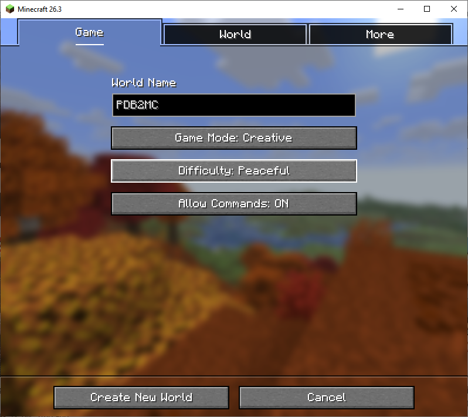

3. On the `World` tab, change the following:
    1. `World Type: Superflat`
    2. `Generate Structures: OFF`
    3. `Bonus Chest: OFF`
    4. Select `Customize` to give the world a white floor (not required, but suggested).

    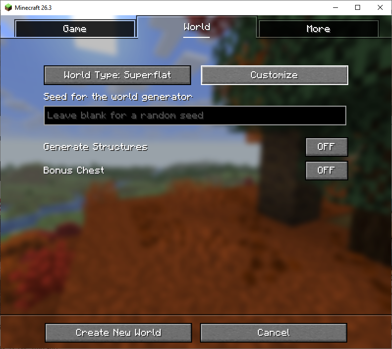

4. In `Superflat Customization`, select `Presets`. Replace the text in the top box with
   `minecraft:bedrock,minecraft:white_concrete` and select `Use Preset`.

    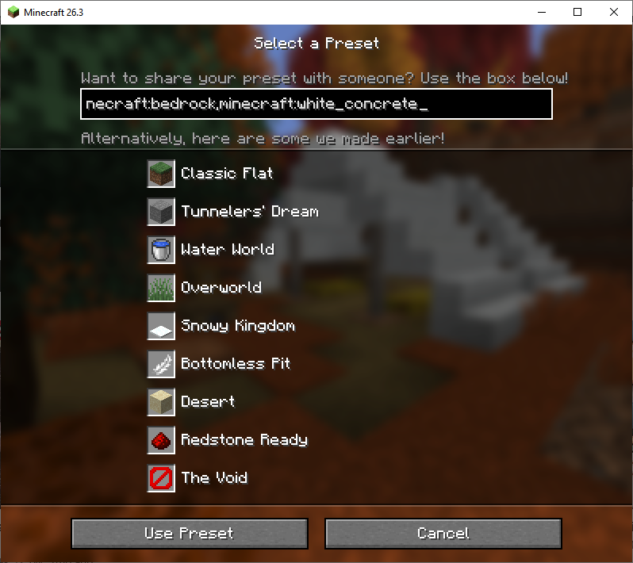

5. Back in `Superflat Customization`, the layers now read `White Concrete` on top and `Bedrock` at the bottom. Select
   `Done`.

    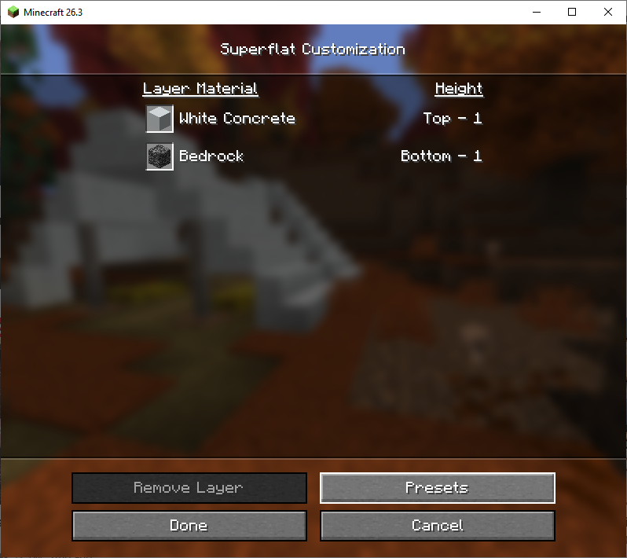

6. On the `More` tab, select `Game Rules` and turn these off, so nothing wanders into or changes around your models:

    1. Under `Spawning`: `Spawn mobs`, `Spawn Monsters`, `Spawn pillager patrols`, `Spawn phantoms`,
       `Spawn Wandering Traders` and `Spawn Wardens`: all `OFF`
    2. Under `World Updates`: `Advance time of day` and `Update weather`: both `OFF`

    Then select `Done`.

    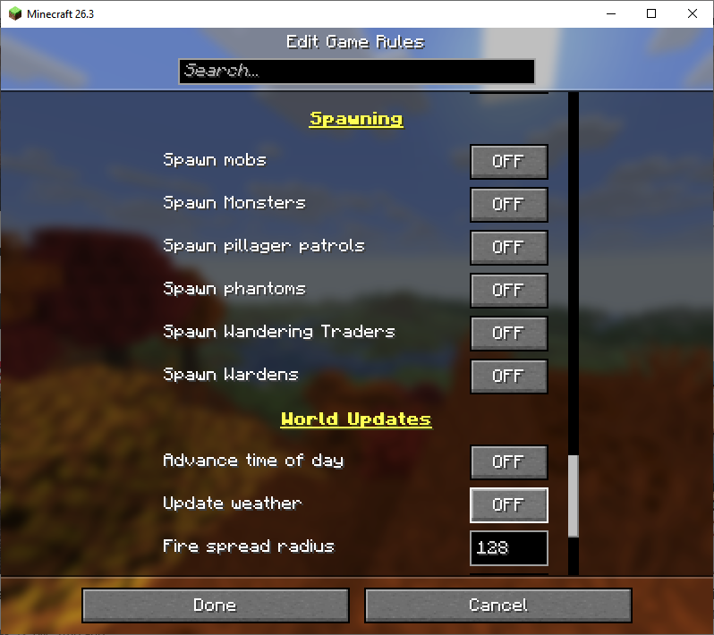

7. Select `Create New World` to create the world.
    - Minecraft can be closed until the model is made, or kept open.

## Walkthrough of an example GFP model

### Choose a structure

> [!NOTE]
> `PDB2MC` comes with several example models and models of the individual amino acids: press `Included Model` to use
> one. The steps below show how to find a structure on the RCSB PDB website. If you already know its PDB ID, you can
> skip them and use `Load PDB ID` in the program instead.

1. Navigate to [https://rcsb.org](https://www.rcsb.org/)
   - For ease, there is an `RCSB.org` button in the program that will open this website.
   - This is the home page for the RCSB PDB website. It contains a search bar and links to other resources.
2. In the Search bar, search for a biomolecule (For this example: "Green fluorescent protein")

    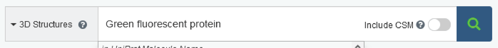

3. Select a structure (For this example: the model named "1GFL")
    - This is the entry for published structures. It contains 3D previews, sequences, and structure information as well as the original citation.
    - The four characters "1GFL" are its PDB ID.

    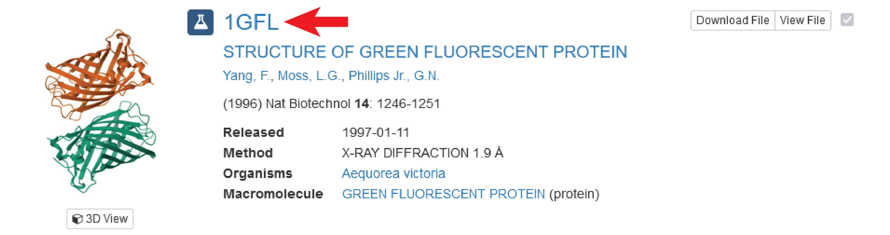

4. To use a file rather than the PDB ID, select `Download Files` and download the `PDBx/mmCIF Format` (`.cif`) or
   `PDB Format` (`.pdb`) file. Take note where this file is saved.
    - Large structures (more than about 60 chains) only work properly as `.cif` files: the `.pdb` format cannot name
      that many chains.

    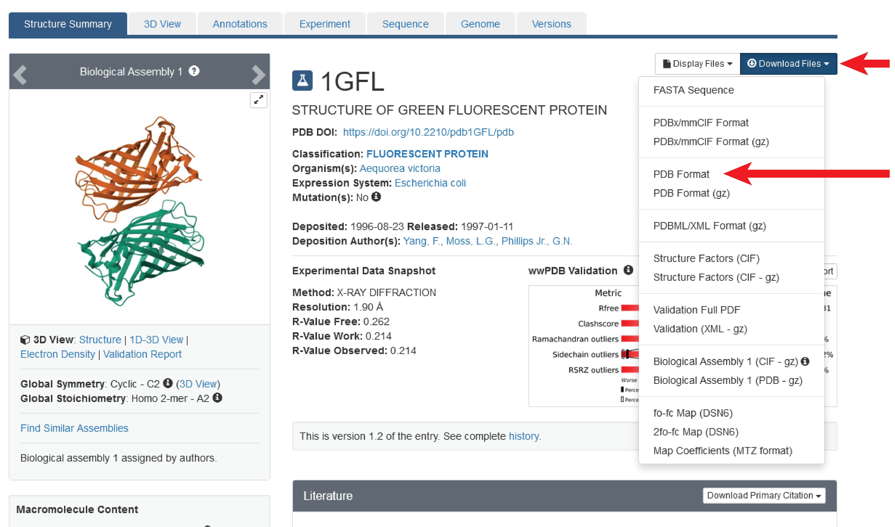

### Make the model in PDB2MC
- Select the desired mode
  - For this example, select `Ribbon` from the `Select Mode:` dropdown menu

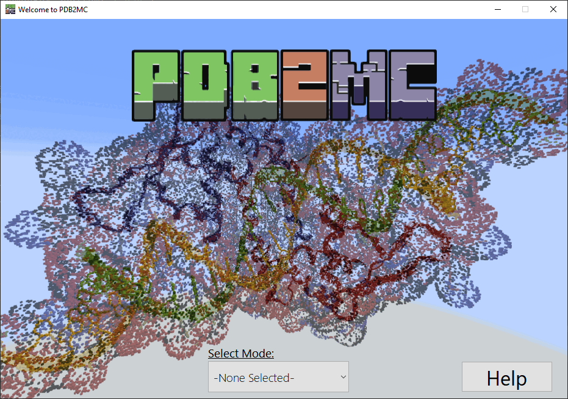

> [!NOTE]
> Descriptions of the different modes are included in the next section.

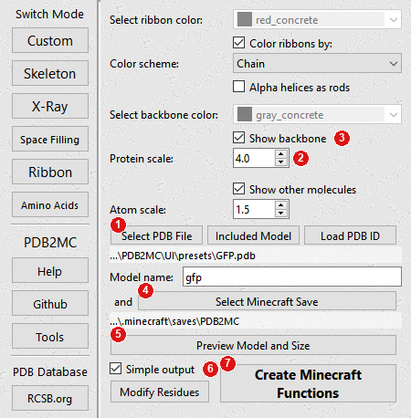

1. Choose the structure, in any of three ways:
    - Press `Load PDB ID` and type `1GFL` to download GFP from the RCSB Protein Data Bank (needs an internet
      connection);
    - press `Included Model` and choose `GFP`; or
    - press `Select PDB File` and choose the file you downloaded (a `.pdb`, `.cif` or `.mmcif` file).

    A message shows the largest `Protein scale` that fits in the world, and `Protein scale` is set to it (rounded
    down to a whole number).
2. Change `Protein scale` to 4.0, a comfortable size for exploring GFP.
3. Ensure that `Show backbone` is checked.
4. Press `Select Minecraft Save` and choose the Minecraft world.
    - **Note:** Choose the world's own folder inside `.minecraft/saves` (it has the world's name) and press
      `Select Folder`; no other folder is accepted.
5. Press `Preview Model and Size` to see the model and how many blocks it will take up.
6. Ensure that `Simple output` is checked.
   - This will create single "build" and "clear" functions. Unselected, functions for individual parts of the model will be created.
7. Press `Create Minecraft Functions` and wait for the `Finished!` window. It lists the commands for this model in
   Minecraft:

    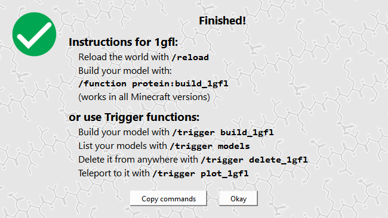

    - `/reload`: run this first, so the world finds the new model.
    - `/function protein:build_<name>`: builds the model where you stand. It works in every Minecraft version, but needs
      commands allowed (cheats) or operator rights.
    - The `/trigger` commands work for every player, even with commands not allowed (Minecraft 1.20.2 or newer): build the model, list
      all models, delete this model from anywhere, and teleport to it. See [In-game commands](#in-game-commands).
    - `Copy commands` copies all six commands at once, as plain text with one command per line (the button then shows
      `Copied!`). Paste them into notes or a handout for a class; Minecraft's chat takes one command at a time. To copy
      a single command, select it with the mouse and press `Ctrl+C`.
    - The program *does not* have to be closed in case changes need to be made and the Minecraft model regenerated.

> [!NOTE]
> Steps 2 to 6 may be taken in any order, and options a mode does not use are ignored.
> Details on the options are described in the next section.

### Build the model in Minecraft
1. If not already open, start Minecraft and open the world intended to generate the model
2. Open the Minecraft chat by pressing `t` on your keyboard
3. Type `/reload` to reload the Minecraft world and guarantee that the functions are recognized by the game
4. Move to a desired location in the world.
    - The model will be generated *relative to the player* and best results for most models will be created while the player is on the ground.
    - The Minecraft command `/tp @s ~ ~ ~1000` will send you 1,000 blocks away from the current location. This is useful to separate multiple models.
5. **To generate the model:**
    - The commands for your model are listed in the `Finished!` window (step 7 of [Make the model in PDB2MC](#make-the-model-in-pdb2mc)).
    - Type `/function protein:build_` which will bring up the main command, press `tab` to autocomplete for your model.
       * **Note:** Each model is named after its PDB ID, in lowercase: for the GFP example, `build_1gfl`. A name typed
         in `Model name` is used instead.
    - Press `Enter` to start the generation.
    - Players without operator rights can use `/trigger build set <number>` or `/trigger build_<name>` instead, see [In-game commands](#in-game-commands).

> [!TIP]
> Individual parts of the model can be separately generated by de-selecting `Simple output` and individually using the
> other functions. They are named after the part, and big parts are split into numbered pieces: for example
> `build_1gfl_backbone_part0` to `build_1gfl_backbone_part3`, `build_1gfl_atoms_part0`, `build_1gfl_hetatm_part0`
> (other molecules) or `build_1gfl_a_ribbon_part0` (the ribbon of chain A).
>
> In rare circumstances, due to limitations within Minecraft it may be necessary to call these individual functions if the `build_` function
> does not create the full model.
>
> Any time a function is run to add a component to the same model, stand on the black obsidian block (generated after
> the first command) to ensure the model components are placed correctly.

6. **To clear the model:**
    - Type `/function protein:clear_` which will bring up the clearing command, press `tab` to autocomplete for your model.
    - Press `Enter` to remove the model. You can be anywhere in the world when you do this.

> [!NOTE]
> The world remembers where each model was built, so it can be removed from anywhere. Models built with an earlier version of
> PDB2MC, or on Minecraft older than 1.20.2, are not remembered: for those, stand on the black `obsidian`
> block that was generated with the model before you run the clear command.

## In-game commands
Every model can be built, deleted and found from inside Minecraft. `/trigger` commands work for every player, with no
operator rights and with commands (cheats) turned off, so a whole class can share one world. Each command takes either the model's
number or its name:

| What it does | By number | By name |
|---|---|---|
| List all models in the world, with their numbers | `/trigger models` | |
| Build a model where you stand | `/trigger build set <number>` | `/trigger build_<name>` |
| Delete a model, from anywhere | `/trigger delete set <number>` | `/trigger delete_<name>` |
| Teleport to a model | `/trigger plot set <number>` | `/trigger plot_<name>` |
| Teleport back to the world spawn | `/trigger spawn` | |

The `/function` commands keep working and use the same records, so you can build a model with one kind of command and
delete it with the other:

| What it does | Function command |
|---|---|
| Build a model where you stand | `/function protein:build_<name>` |
| Delete a model, from anywhere | `/function protein:clear_<name>` |
| List all models | `/function pdb2mc:list` |

- A model can be built in as many places as you like. Deleting and teleporting use the newest copy, so delete again to
  remove the next one. `/trigger models` shows how many copies each model has.
- Far-away models take a moment to delete, because Minecraft has to load that part of the world first.
- New models appear after `/reload` (or after opening the world again), the same as `/function` commands.
- A model keeps its number when you rebuild it.
- `/reload` and `/function` need commands allowed (cheats) or operator rights; `/trigger` does not.

> [!NOTE]
> `/trigger` commands and deleting from anywhere need Minecraft 1.20.2 or newer. On older versions the `/function`
> commands work the way they always did.

> [!WARNING]
> Deleting uses the current version of a model. If you rebuild a model with different settings while an older copy
> is still in the world, parts of the older copy may stay behind, so delete a model before you change it.

## Description of Program modes

1. **Custom**: This mode allows for the most customization of the visualization of atoms and bonds. Useful if you want
   to add, remove, or modify most elements of the model.
<p align = "center">
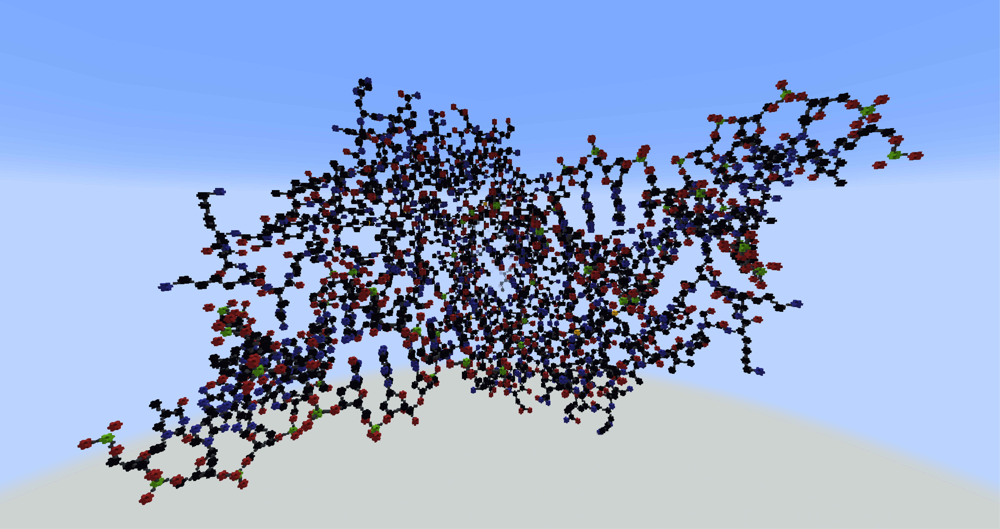
</p>

2. **Skeleton**: Makes a simple model of the protein backbone and sidechains. These represent the bonds between atoms,
   without showing the atoms themselves. Useful for visualizing the overall shape of the protein with or without amino
   acid side chains.
<p align = "center">
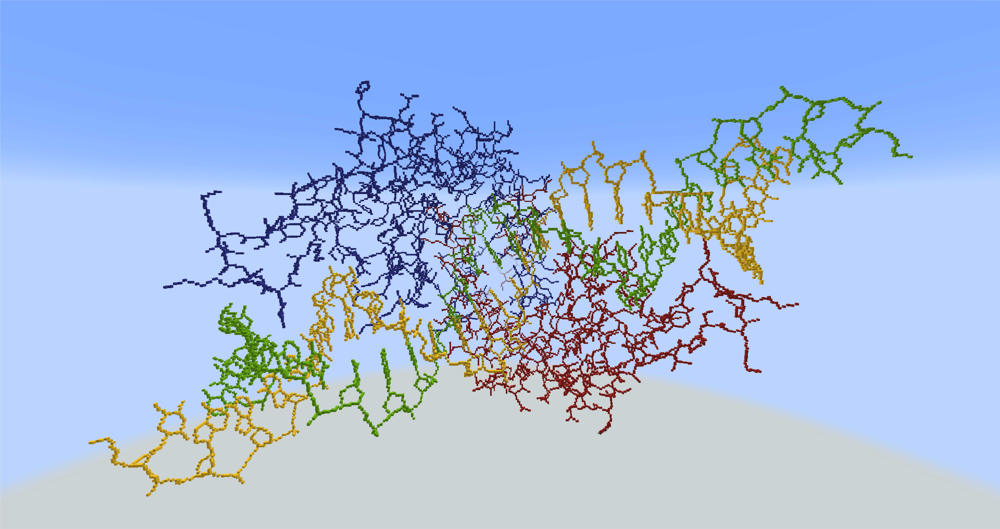
</p>

3. **X-Ray**: Shows both the atoms and the bonds. The atoms are glass blocks and the bonds opaque blocks, so the bonds
   between atoms can be seen through the atoms.
<p align = "center">
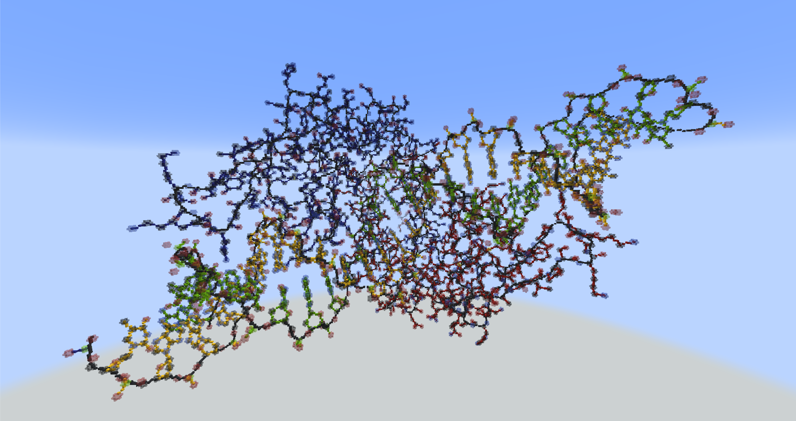
</p>

4. **Space Filling**: This mode creates a model of the "Solvent-Accessible Surface" (SAS): the surface traced by the
   centre of a water-sized ball (radius 1.4 Å) rolled over the atoms, each atom being a sphere of its van der Waals
   radius. It shows the space that "solvents" like water cannot enter around large biomolecules, which gives the
   general appearance of what a protein would look like if it were scaled up. `SASA radius` in the window changes the
   size of the ball: larger values give a smoother surface that hides small grooves, and 0 gives the plain van der
   Waals surface. Inside the protein, the bonds are created as a `skeleton` model, so exploring the interior shows how
   the overall shape and the bonds between atoms are connected.

   (How it is computed: points are spread over a sphere of radius (van der Waals radius + SASA radius) around every
   atom, and the points not inside any other atom's sphere form the surface: the Shrake–Rupley algorithm.)
<p align = "center">
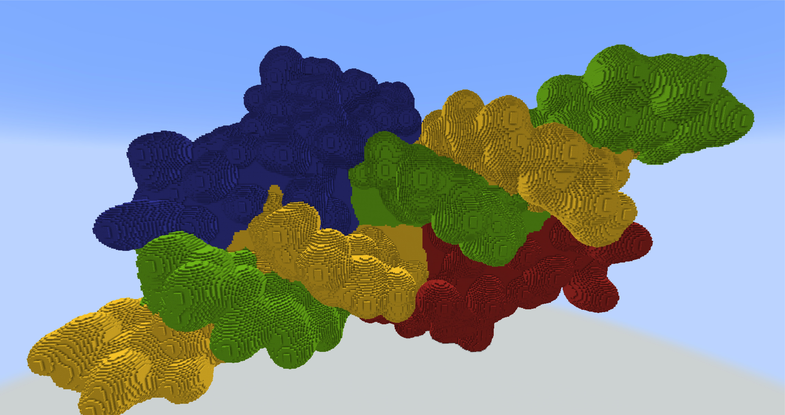
</p>

> [!WARNING]
> Space Filling models of large structures at high scales contain many blocks and may take Minecraft a long
> time to place. Only the outer layer of the surface is placed, which keeps the block count down.

5. **Amino Acids**: Each amino acid is shown as a single sphere on the backbone, colored by which amino acid it is.
   This is not a true representation of the atoms, but it shows the overall shape of the protein and where each amino
   acid is. `Color style` fills in all 20 colors at once: one color per amino acid, or colors by type, charge,
   hydrophobicity or size. `Residue scale` sets the size of the spheres; it follows `Protein scale` (the same number)
   until you change it yourself.
<p align = "center">
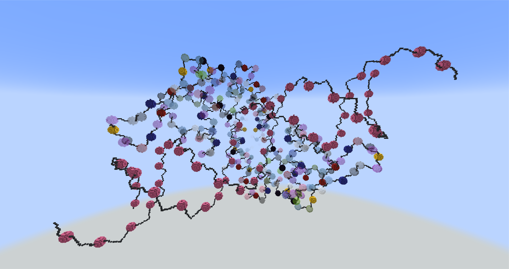
</p>

6. **Ribbon**: A cartoon of the protein, the way structures are drawn in textbooks. Alpha-helices are spiral ribbons,
   beta-strands are flat ribbons ending in an arrow that points along the chain, and the loops in between are thin
   tubes. The curve passes through every amino acid's alpha carbon. DNA and RNA are shown as their backbone with the
   bases attached. This mode is useful for visualizing the secondary and tertiary structure of the protein.
   - Where helices and strands are comes from the structure file. When a file does not say (most AlphaFold predictions
     and many home-made models), PDB2MC works them out from the backbone's hydrogen bonds, the same way the Protein
     Data Bank does (the DSSP method).
   - `Alpha helices as rods` draws each helix as a straight rod from its start to its end instead of a spiral.
   - Other molecules bonded to the protein, such as heme bound to a histidine, have their bond drawn to the ribbon.
   - The ribbon's thickness is set by `ribbon_thickness` near the top of `PDB2MC/ribbon.py` (with suggested values).
<p align = "center">
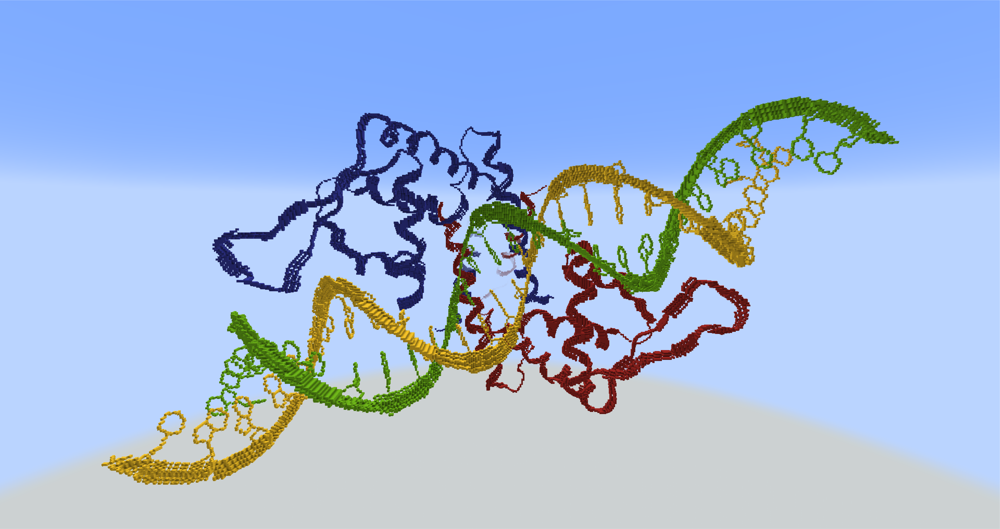
</p>


## Description of options

1. Features common to most-or-all modes

   - `Scale determination:` Once a structure is chosen, the program works out the size of the model and suggests a
   maximum scale for it. This is to prevent the model from being too large for Minecraft's limited up-and-down (Y) axis.
   `Protein scale` is set to this maximum, rounded down to a whole number; you can still change it.
   - `Switching modes:` The selected model, its name, Minecraft save, residue changes and chain colors carry over when
   you switch to another mode.
   - `Tool tips:` Rest the mouse on any option for a short description.
   - `Load PDB ID:` Type a PDB ID, such as 1GFL, to download that structure from the RCSB Protein Data Bank (this needs
   an internet connection). Structures are downloaded as mmCIF files, which work for structures of any size, and are kept
   in a "structures" folder next to the program's settings, so the same ID is only downloaded once.
   - `Preview Model and Size:` Shows the model turning in a box, colored with the current settings, and about how many
   blocks wide, deep and high it will be at the current `Protein scale`, with a warning when it is too tall for the world
   or so wide that loading it will be slow.

     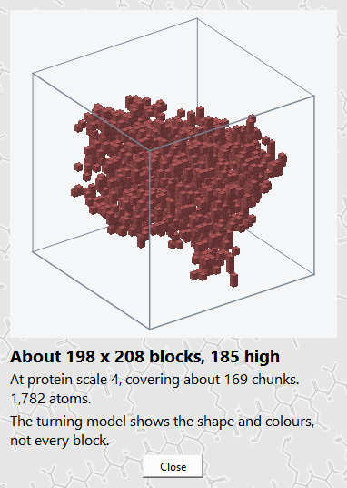

   - `Model name:` Selecting a structure fills in its PDB ID (the included examples use their own name). Type another
   name to use that instead; it can hold letters, numbers, dots and dashes, and anything else becomes a dash.
   - `Rotation of model:` When the model is made, it is turned so that its shortest side points up (the Y axis), so it
   fits in Minecraft's limited height.
   - `Removal of Hydrogen and Water:` Due to the nature of X-ray crystallography, hydrogen atoms are often not captured
   in the structure file. Additionally, water molecules are often present in the crystal and are not part of the protein.
   If present, these atoms are removed from the visualization.
   - `Alternate positions:` Some structure files give two or more possible positions for parts of an amino acid, when
   its exact orientation is not known. Only the first position is used.
   - `Multiple models:` Files with several models of the same molecule (common for NMR structures) use only the first.
   - `Minecraft datapack:` When a new Minecraft world first has model functions generated, a "datapack" is required.
   The program will automatically generate the datapack file structure and place the required pack.mcmeta file in the datapack.


2. `Atom scale`: The size of each atom's sphere, as its diameter in blocks (rounded up). It does not change the
distances between atoms. In Amino Acids mode this option is called `Residue scale`.

3. `Protein scale`: How big the whole model is: the distances between atoms are multiplied by it, so at scale 1 one
angstrom is one block. Bigger models show more detail but take more blocks and more time to build. Because
`Atom scale` does not change the distance between atoms, the two together let you show the bonds between atoms more or
less clearly.

4. `Select _____ color`: These options set the Minecraft block that represents a particular atom, group of atoms, or
bond. Choose from the list or type the name of any decorative block. "Other color" is used for atoms of the less
common elements.

5. `Color backbone by:` and `Color scheme`: If checked, the backbone (and sidechains, ribbons or surface, depending on
the mode) is colored by the chosen scheme instead of one color:
   - `Chain`: each chain its own color. Single protein, DNA, or RNA molecules are considered chains; useful to view the
   different subunits that make up a full complex.
   - `Molecule`: every copy of the same protein or nucleic acid gets the same color, so a complex of many copies of a few
   proteins shows which protein is which.
   - `Hydrophobicity`: each amino acid by how much it avoids water (Kyte-Doolittle scale), from blue (likes water) to
   orange (avoids water). Water-avoiding residues usually sit inside a protein.
   - `Charge`: positive amino acids blue, negative ones red, the rest white. DNA and RNA are negative.
   - `Confidence`: blue where the structure is most sure of the atom positions, orange where it is least sure. This uses
   the B-factor of experimental structures, and the pLDDT score of AlphaFold predictions.

   With the `Chain` and `Molecule` schemes, checking the box opens the list of chain colors: type block names (with
   autocomplete) to add them, reorder or remove them, or press "Default" for the preset bright colors. Chain 1 uses the
   first block, chain 2 the second, and the list repeats when a model has more chains than blocks. The blocks of the
   other schemes are set in `PDB2MC/color_schemes.py`.

6. `Backbone _____`: The protein backbone is the chain of atoms that runs through every amino acid: the N, alpha carbon
and C atoms of each amino acid (and the sugar-phosphate chain of DNA and RNA). These options change its color and
thickness, or hide it.

7. `Sidechain _____`: The sidechain is the variable R group of each amino acid. These options change its color, or
hide it.

8. `Show other molecules`: Shows the atoms and bonds of the other molecules in the structure file, such as ligands,
co-factors, ions or substrates bound to the protein. They are always shown as a "ball-and-stick" model.

9. `Use "mesh-style" atoms`: Places only some of each atom's blocks, as a "cloud" rather than a full sphere, so the
model uses fewer blocks and the bonds inside can be seen. In Space Filling mode it does the same to the surface.

10. `Modify Residues`: Opens the sequence of every chain. Select residues (click, shift-click or drag) and choose:
   - `Assign Block Type`: every block of those residues, in every part of the model (atoms, backbone, sidechain, ribbon
   or surface), uses this block instead of its normal color.
   - `Hide Selection`: those residues are left out of the model entirely.
   - `Clear Changes`: undoes the changes of the selected residues, or of all residues when nothing is selected.

   Press `Okay` to use the changes; they apply in every mode until another structure file is selected.

11. `Help` button: Opens this guide inside the program.

12. `Github` button: Opens the GitHub page of PDB2MC in your web browser, where new releases are published.

13. `RCSB.org` button: Opens the RCSB PDB website in your web browser. This is where you can look up structures and
their PDB IDs, and download their files.

### Tools
The `Tools` button in every mode opens these utilities:

- `Metal Ion Settings`: Sets the block for each metal ion, in every mode. Metals not in this list use the "other"
color. These choices are saved, along with the default folder below, in a settings file in your user folder
(`%APPDATA%\PDB2MC\settings.json` on Windows), so they stay when you close the program or update it.
- `Default PDB/CIF Folder`: Sets the folder that the `Select PDB File` button starts in.
- `Remove Function Files`: Removes every PDB2MC model's files from a Minecraft world (the blocks already built stay;
clear them in Minecraft first).
- `Open Minecraft Function Directory`: Opens the folder of the selected world's model files.
- `Open 'Presets' Directory`: Opens the folder of the included example models. `.pdb` files copied into it appear
under `Included Model`.
- `Copy Blank World to Minecraft`: Adds a ready-made world named `PDB2MC` to your Minecraft saves, set up for models
(see [Preparing a Minecraft world](#preparing-a-minecraft-world-for-pdb-models)). Running it again replaces that world.

### Default atom colors
Below is a table of the default colors for each atom. These are the colors that will be used if the user does not
select alternatives. Custom and Space Filling mode use concrete blocks and X-Ray mode stained glass; the other
molecules in Skeleton, Ribbon and Amino Acids mode use wool of the same colors.

| Abbreviation | Atom | Color | Can be changed? |
|---|---|---|---|
| C | Carbon |  Black |  Yes |
| O | Oxygen |  Red |  Yes |
| N | Nitrogen |  Blue |  Yes |
| S | Sulfur |  Yellow |  Yes |
| P | Phosphorus |  Green |  Yes |
| H | Hydrogen |  White |  No |
| Fe | Iron |  Iron block |  Yes, in `Metal Ion Settings` |
| - | Other |  Pink |  Yes |


## Command line
Models can also be built without the window, with each mode's default settings:

`python -m PDB2MC.cli Ribbon path/to/model.cif "<path to>/.minecraft/saves/<world>" --scale 2`

- The structure can be a `.pdb`, `.cif` or `.mmcif` file, or a PDB ID such as `1GFL`, which is downloaded.
- Options: `--scale`, `--by-chain`, `--no-hetatm` (leave out other molecules), `--mesh`, `--name` (the model's name in
Minecraft) and `--sasa-radius` (Space Filling).
- Modes: `Custom`, `Skeleton`, `X-Ray`, `"Space Filling"`, `Ribbon`, `"Amino Acids"`.


## Glossary of terms

1. **X-ray Crystallography**: A method of determining the structure of a molecule by shooting X-rays at a crystal of
the molecule. The X-rays are deflected by the electrons surrounding the atoms of the molecule. By measuring this
"diffraction" pattern, the structure of the molecule can be determined.

2. **PDB and PDB ID**: The Protein Data Bank (PDB) is the public archive of the 3D structures of proteins, DNA, RNA and
other biomolecules. Each structure has a four-character PDB ID, such as 1GFL. Its file holds the coordinates of every
atom and other information about the structure; it is not easy for people to read, and needs a program to visualize
the structure.

3. **PDB and mmCIF files**: The two file formats structures come in. The older `.pdb` format is simpler but limited: it
cannot hold very large structures properly. The newer `.cif` (mmCIF) format is the Protein Data Bank's own and works for
every structure. PDB2MC reads both.

4. **Protein/Enzyme**: A protein is the biomolecule that makes up the structural and functional machines of all cells.
Protein is a more general term for any of these molecules made from amino acids and encoded by the DNA of the
organism. Enzymes are proteins that have a specific function, such as catalyzing a reaction to make a product.

5. **Primary, Secondary, Tertiary, Quaternary structures**: Proteins can be described in terms of their structure. The
primary structure is the first level of structure and is the amino acid sequence of the protein. Secondary structure
are the local structures within stretches of amino acids in a protein such as alpha helices and beta sheets. Tertiary
structure is the overall structure of the protein and is the primary structure folded into a 3D shape. Quaternary
structure describes when multiple proteins come together to form a larger complex potentially with more or a
different function than the individual proteins.

6. **Amino Acid**: Amino acids are the building blocks of proteins. Each individual amino acid "residue" has backbone
atoms: An amino (N) group, a carboxyl (C=O) group, and a center carbon atom (the alpha carbon). The center carbon has a
variable "R" group which may be as small as a single hydrogen atom or as large as a carbon ring structure. The R group
determines the properties of the amino acid.

7. **Backbone and Sidechain**: These terms refer to the parts of an amino acid. The backbone is the amino and carboxyl
groups and the center carbon, thus when visualized, appears to be a long string that snakes through the protein. The
sidechain is the variable R group that gives each individual amino acid its unique properties. In certain models,
these are visualized as shapes that protrude from the backbone.

8. **Ligand, Co-factor, Substrate**: These terms refer to small-to-medium sized molecules that interact with proteins. A
ligand is a molecule that binds to a protein and may change the function of the protein. A co-factor is a molecule that
is required for the protein to function. A substrate is a molecule that is acted upon by the protein which may be
changed into a product.

9. **DNA and RNA**: These molecules represent the beginning and middle stage of the central dogma: DNA is the molecule
that makes up the genome, where genetic information is stored and inherited. RNA is the short-lived messenger molecule
that is transcribed from the DNA. Some RNA molecules are translated into proteins, but others may have other functions.
DNA and RNA differ in structure as well as function: RNA has an extra hydroxyl group on its ribose sugar and is
single-stranded, while DNA lacks this hydroxyl and is often double-stranded.

10. **Heteroatom and Atom**: These terms are used to describe the atoms that make up the molecules in the structure
file. Both are atoms and most often Carbon, Oxygen, Nitrogen, Phosphorus, and Sulfur, however some heteroatoms are
metals or other elements. In the structure file, the Protein, DNA, and/or RNA atoms are denoted as "atoms", while the
atoms that make up ligands, co-factors, and substrates are denoted as "heteroatoms".

11. **Bond**: A bond is the connection between two atoms. This represents the sharing of electrons between two atoms
(in "covalent bonds"), or a metal ion held by the atoms around it. Hydrogen bonds and ionic bonds are not drawn.

12. **AlphaFold and pLDDT**: AlphaFold is a program that predicts a protein's structure from its sequence, rather than
measuring it in an experiment. Its predictions come with a confidence score for each amino acid, pLDDT (0-100, higher
is more confident), which the `Confidence` color scheme shows.

## Generalized Flowchart of Program Procedure

A generalized flowchart of the program procedure is shown below. This is a simplified version of the actual program
procedure, and what happens in the middle depends on the mode and options selected.

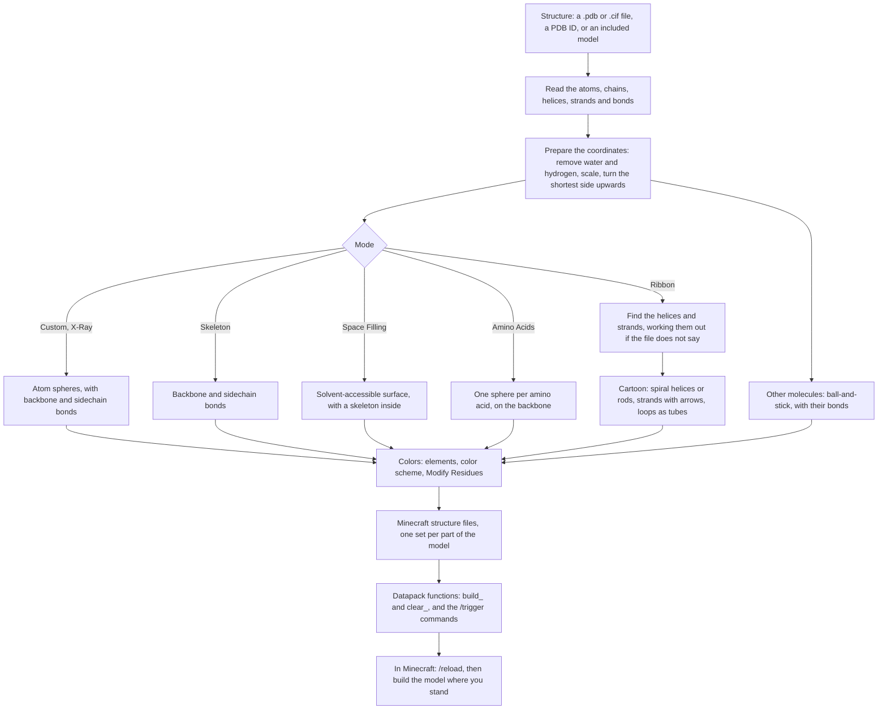

## Acknowledgements
- Thanks to Max Canoodt (@mcndt) for the Minecraft block color data.
- Thanks to Joey Ross for his advice and his help updating the code.
- The original code of PDB2MC was written by Markus Nevil, and later augmented with the help of GitHub Copilot.
  Claude Code has since been used to further improve its performance.

## Citation
*PDB2MC is not yet published with an associated paper, however if you use PDB2MC in your research, please cite the following:* <br>

Nevil, M. 2024. [**PDB2MC: Bridging Biomolecules and Minecraft for accessible, interactive 3D visualization.**](https://github.com/markus-nevil/PDB2MC).

```
@article{NevilMarkus2024,
author = {Nevil, M.},
title = {PDB2MC: Bridging Biomolecules and Minecraft for accessible, interactive 3D visualization.},
year = {2024},
}
```

## License

MIT License

Copyright (c) 2024 Markus Nevil

Permission is hereby granted, free of charge, to any person obtaining a copy
of this software and associated documentation files (the "Software"), to deal
in the Software without restriction, including without limitation the rights
to use, copy, modify, merge, publish, distribute, sublicense, and/or sell
copies of the Software, and to permit persons to whom the Software is
furnished to do so, subject to the following conditions:

The above copyright notice and this permission notice shall be included in all
copies or substantial portions of the Software.

THE SOFTWARE IS PROVIDED "AS IS", WITHOUT WARRANTY OF ANY KIND, EXPRESS OR
IMPLIED, INCLUDING BUT NOT LIMITED TO THE WARRANTIES OF MERCHANTABILITY,
FITNESS FOR A PARTICULAR PURPOSE AND NONINFRINGEMENT. IN NO EVENT SHALL THE
AUTHORS OR COPYRIGHT HOLDERS BE LIABLE FOR ANY CLAIM, DAMAGES OR OTHER
LIABILITY, WHETHER IN AN ACTION OF CONTRACT, TORT OR OTHERWISE, ARISING FROM,
OUT OF OR IN CONNECTION WITH THE SOFTWARE OR THE USE OR OTHER DEALINGS IN THE
SOFTWARE.
